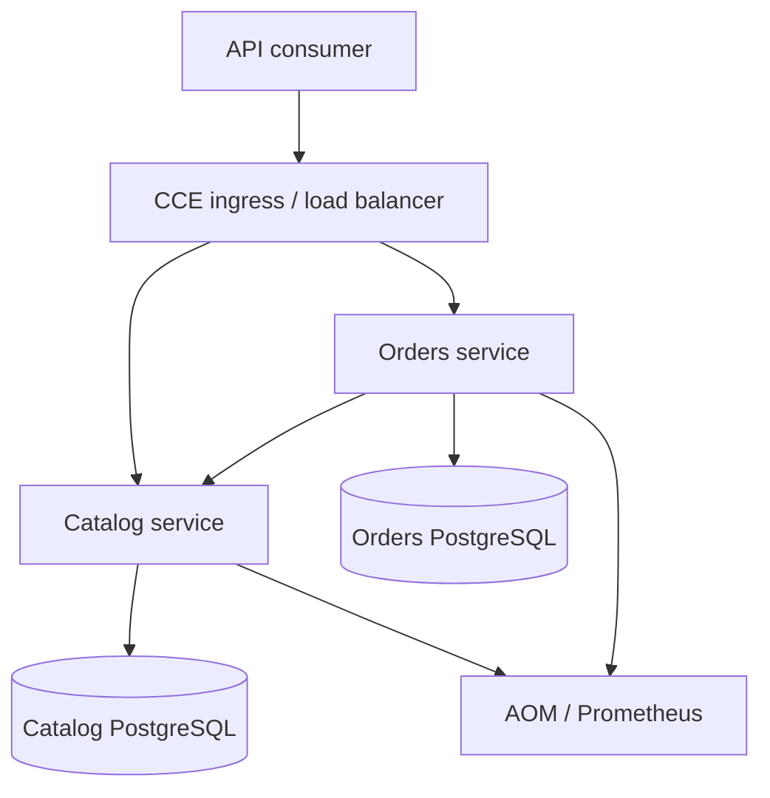
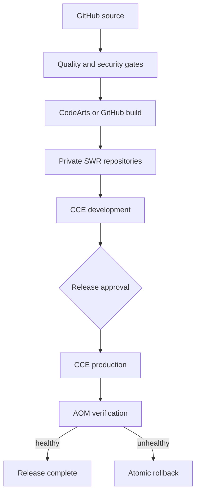

# Architecture

## Runtime view

## Delivery view

## Design decisions

- GitHub is the public, reviewable source-of-truth.
- CodeArts is the Huawei-native production release option.
- Docker images are immutable and stored privately in SWR.
- Helm provides repeatable environment-specific releases.
- Database credentials are referenced from an existing Kubernetes Secret.
- Workloads run as a non-root user with a read-only root filesystem.
- NetworkPolicy limits inbound and outbound workload traffic.
- Inventory is reserved with one conditional `UPDATE products SET stock = stock - n
  WHERE id = ? AND stock >= n`, so concurrent catalog replicas cannot oversell.
- An order is written only after a successful reservation. If the write fails, or a
  concurrent request with the same `X-Idempotency-Key` stored its order first, orders
  calls `POST /api/v1/products/{id}/release` to hand the units back; a duplicate key
  returns the stored order (200) rather than a 500. Release is best effort and logged
  when it fails; a durable outbox is the next step for production.
- AOM and Prometheus-compatible metrics provide operational feedback.
- Orders-to-catalog calls enforce a finite timeout in the `(0, 60]` second range so invalid
  configuration cannot disable the dependency boundary or create excessive request stalls.

## Environment separation

| Environment | Namespace | Deployment | Purpose |
|---|---|---|---|
| Development | `commerce-dev` | automatic | fast integration feedback |
| Staging | `commerce-staging` | automatic after gates | production-like validation |
| Production | `commerce-prod` | protected approval | controlled release |

